# AI 도서 추천 서비스

```
[브라우저] ──HTTP──▶ [Django web :8080] ──HTTP──▶ [FastAPI proxy :8081] ──▶ GMS(OpenAI 호환 API)
             화면·폼·흐름 제어                    모델 호출·Guardrail 집행·키 은닉
```

- **web (Django, SSR)**: 사용자가 이용하는 서비스. 폼 검증, 템플릿 렌더링, 여러 API 호출의 순서 제어. JS 없음.
- **proxy (FastAPI)**: Proxy 서버. `GMS_KEY`를 유일하게 가지며 GMS에 요청을 대신 보냅니다. Guardrail은 생성 API 안에서 항상 먼저 실행됩니다.
- 브라우저는 Django(8080)만 호출합니다. FastAPI(8081)는 Django만 호출합니다.

## 팀 구성

| 구분 | 이름 | 담당 |
|---|---|---|
| Part A | 피윤아 | 모델 서빙 API와 안전장치 (FastAPI): F702, F703, F706, F707, F709(FastAPI), F710 |
| Part B | 최주희 | 입력·흐름 제어와 멀티모달 화면 (Django + FastAPI 일부): F701, F704, F705, F708, F709(Django), F711, F712 |

## 목차

1. [구현 기능](#1-구현-기능)
2. [실행 결과 캡처](#2-실행-결과-캡처)
3. [엔드포인트](#3-엔드포인트-fastapi-앞에-apiv1)
4. [프로젝트 구조](#4-프로젝트-구조)
5. [실행 방법](#5-실행-방법)
6. [자주 겪는 문제](#6-자주-겪는-문제)
7. [학습 내용](#7-학습-내용)
8. [느낀 점](#8-느낀-점)

---

## 1. 구현 기능

| 번호 | 항목 | FastAPI (proxy/main.py) | Django (web/recommend) | 상태 |
|---|---|---|---|---|
| F701 | 입력 검증 | - | `models.py`, `forms.py`, `recommend_form` | 완료 |
| F702 | 텍스트 추천 생성 | `chat_completions` | `text_recommend` | 완료 |
| F703 | Guardrail | `chat_guardrail`, `ensure_appropriate` | `rejected.html` (403) | 완료 |
| F704 | 라우트 결정 | `decide_route` | `decide_route` | 완료 |
| F705 | 이미지 생성 | `image_generations` | `image_recommend` | 완료 |
| F706 | 공통 에러 처리 | `gms_post` (200이 아니면 503) | `error.html` (503) | 완료 |
| F707 | 이미지 분석 | `image_analysis` | `image_analysis` | 완료 |
| F708 | API 흐름 제어 | - | `recommend_flow` | 완료 |
| F709 | 텍스트 응답 점수 (심화) | `chat_score` | `text_recommend` 에 `/chat/score` 호출 추가 | 완료 |
| F710 | 모델 등급 라우팅 (심화) | `decide_model_tier` | 체크박스 (`use_tier_routing`) | 완료 |
| F711 | TTS (심화) | `MODEL_TTS`, `generate_speech` | `tts`, `result_audio.html` | 완료 |
| F712 | 이미지 미디어 서빙 (심화) | - | `image_recommend` 에서 jpg 저장 | 완료 |

### 비기능 요구사항

| 번호 | 항목 | 구현 방법 |
|---|---|---|
| NF701 | URL 구성 | `recommend/urls.py` 에 `app_name='recommend'` 지정, 템플릿 링크는 `` 사용 |
| NF702 | API Key 관리 | `GMS_KEY` 는 `server/proxy/.env` 에만 저장하고 `os.getenv` 로 읽음. `.env` 는 `.gitignore` 에 등록. Django 와 브라우저는 키를 갖지 않음 |
| NF703 | CSRF 보호 | POST 폼마다 `` 포함 |
| NF704 | 호출 시간 제한 | FastAPI → GMS `timeout=120`, Django → FastAPI `timeout=180` (Django 쪽이 더 길어 FastAPI 의 오류 응답을 받아 안내 화면을 보여줄 수 있음) |

### Part A. 모델 서빙 API와 안전장치 (FastAPI)

- **담당:** 피윤아
- **주제:** GMS 호출을 대신하는 Proxy 서버의 공통 에러 처리, Guardrail, 텍스트·이미지 분석 API, 점수 계산과 모델 등급 라우팅
- **담당 요구사항:** F702, F703, F706, F707, F709(FastAPI), F710

**F706 공통 에러 처리 (`gms_post`)**
- 모든 GMS 호출이 지나가는 공통 함수입니다. 응답 코드가 200이 아니면 호출 경로, 상태 코드, 응답 본문 앞부분을 터미널에 남기고 `HTTPException(503, "model server error")` 를 발생시킵니다.
- `ensure_appropriate` 가 발생시킨 403은 503으로 바뀌지 않고 그대로 전달되도록 했습니다.
- 외부 호출에 `timeout=120` 을 지정했습니다. (NF704)

**F703 Guardrail (`chat_guardrail`, `ensure_appropriate`)**
- `chat_guardrail`: 판단 기준을 `developer` 메시지로, 사용자 입력을 `user` 메시지로 보내고, `response_format` 에 `is_appropriate`(boolean) 하나만 갖는 JSON 스키마를 지정해 `{"is_appropriate": true/false}` 로 반환합니다.
- 판단 기준은 폭력·자해·혐오·성인 콘텐츠, 명백히 불법인 행위, 타인의 개인정보 요구만 부적절로 보고, 모호하면 통과시킵니다.
- `ensure_appropriate(prompt)`: 결과가 `false` 이면 403을 발생시키고, 판단 자체가 실패하면 `gms_post` 가 503을 내서 요청을 통과시키지 않습니다.
- 텍스트 추천·이미지 생성·이미지 분석 엔드포인트의 첫 줄에서 호출합니다. `messages` 입력은 마지막 메시지의 `content` 를, 이미지 분석은 질문 텍스트만 검사합니다.

**F702 텍스트 추천 생성 (`chat_completions`)**
- Guardrail을 통과한 요청만 `ask_gms(messages, MODEL_NANO)` 로 경량 모델에 보내 추천 도서와 이유를 생성하고, `{"content": ..., "model_used": ...}` 형태로 반환합니다.

**F707 이미지 분석 (`image_analysis`)**
- `user` 메시지의 `content` 에 `{"type": "image_url", "image_url": {"url": data URI}}` 와 `{"type": "text", "text": 질문}` 을 함께 담아 보냅니다.
- `developer` 메시지로 "책 표지를 보고 제목·장르를 추정하고 비슷한 도서를 추천" 하도록 지시하고, 답변을 `{"content": ...}` 로 반환합니다.

**F709 응답 점수 (`chat_score`, FastAPI 쪽)**
- 요청(`messages`)과 추천 답변(`answer`)을 받아 사용자의 취향에 얼마나 적합한지 0~100점(`score`)과 이유(`reason`)를 JSON으로 반환합니다. 프롬프트와 `response_format` 은 Guardrail과 같은 방식으로 작성했습니다.

**F710 모델 등급 라우팅 (`decide_model_tier`)**
- 비용이 적은 `gpt-5-nano` 가 요청을 `"simple"` 또는 `"complex"` 로 분류합니다.
- `chat_completions` 는 `use_tier_routing` 이 `true` 일 때 그 결과에 따라 `gpt-5-nano` 또는 `gpt-5-mini` 로 답변을 생성하고, 사용한 모델 이름을 `model_used` 로 함께 반환합니다.

### Part B. 입력·흐름 제어와 멀티모달 화면 (Django + FastAPI 일부)

- **담당:** 최주희
- **주제:** 사용자 입력 검증, 요청 흐름 제어(라우트 결정 → 실행 → 결과 정리), 이미지·음성 결과 화면 구현
- **담당 요구사항:** F701, F704, F705, F708, F709(Django), F711, F712

**F701 / F704 / F705**
- F701: `Recommendation.request_text`(TextField, max 300) 와 `RecommendationForm` 으로 필수 입력·글자 수를 검증하고, `makemigrations` / `migrate` 로 DB에 반영
- F704: 요청이 텍스트 추천인지 표지 이미지 생성인지 판단하는 `decide_route` (`response_format` 으로 `route` 만 반환하도록 제한)
- F705: 이미지 생성 모델을 호출해 `b64_json` 을 `image_base64` 로 반환 (`quality: low`, `output_format: jpeg` 로 비용 절감)

**F708 입력 흐름 제어 (`recommend_flow`)**
- 한 번의 입력으로 `/decide-route` 호출 → route에 따라 `/images/generations` 또는 `/chat/completions` 호출 → 결과 화면 렌더링.
- 응답 코드별로 화면이 갈립니다.
  - 정상(200) → `recommend_flow.html` (텍스트 결과 또는 이미지)
  - 403 → `rejected.html` (Guardrail 거절)
  - 그 외 → `error.html` (503)

**F709 응답 점수 (Django 쪽)**
- `text_recommend` 에서 추천 결과를 받은 뒤, 같은 `messages` 와 `answer`(추천 결과)를 `/chat/score` 로 보내 `score`, `reason` 을 받아 저장합니다.
- 점수는 부가 정보이므로 점수 요청이 실패해도 추천 결과 화면은 그대로 보여줍니다. (200일 때만 값을 담음)

**F711 TTS (FastAPI ~ Django 풀스택)**
1. FastAPI: `MODEL_TTS = "gpt-4o-mini-tts"` 정의, `generate_speech` 에서 GMS `/audio/speech` 를 호출하고 mp3 바이너리를 base64 문자열로 변환해 반환
2. Django: `tts` 뷰에서 `SpeechForm` 검증 후 Proxy 호출, 실패 시 `error.html`(503)
3. 템플릿: `<audio controls src="data:audio/mp3;base64,{{ audio_data }}">` 로 파일 저장 없이 페이지 안에서 바로 재생

**F712 이미지 미디어 서빙**
- 생성된 이미지를 `base64.b64decode` 로 복원해 `uuid` 파일명으로 `web/media/images/` 에 저장하고, `/media/images/…jpg` 주소로 제공합니다.

### 공통: main.py 오타 수정 (팀 코드 점검)

테스트 중 FastAPI 터미널 로그로 아래 오타를 찾아 수정했습니다.

| 위치 | 틀린 값 | 올바른 값 | 증상 |
|---|---|---|---|
| Guardrail `response_format` | `jsom_schema` | `json_schema` | GMS 400 → 텍스트 추천이 503 |
| `chat_completions` | `user_tier_routing` | `use_tier_routing` | `AttributeError`, 500 |
| `chat_completions` | `"comlex"` | `"complex"` | 에러 없이 항상 nano 모델만 사용 (조용한 버그) |
| `decide_route`, `chat_score` | `develpoer`, `developoer` | `developer` | 잘못된 role로 GMS 호출 실패 |

---

## 2. 실행 결과 캡처

각 요구사항의 실행 결과 화면입니다. (이미지 파일은 `screenshots/` 폴더에 있습니다.)

### F701 입력 검증

**① 빈 값으로 보내 오류 메시지가 표시된 화면**

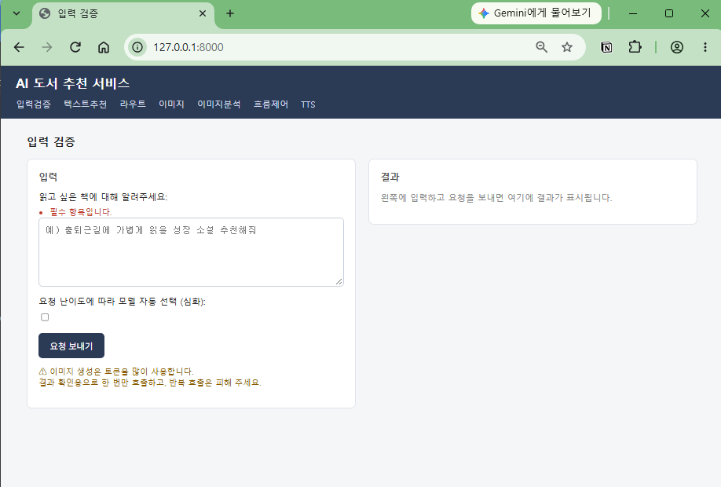

**② 검증을 통과해 저장된 입력값**

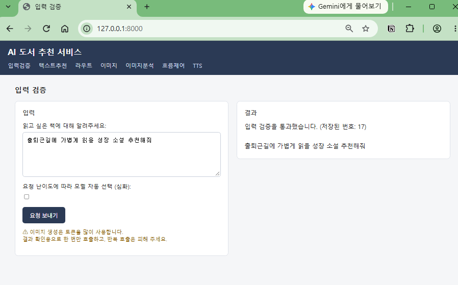

### F702 텍스트 추천 생성

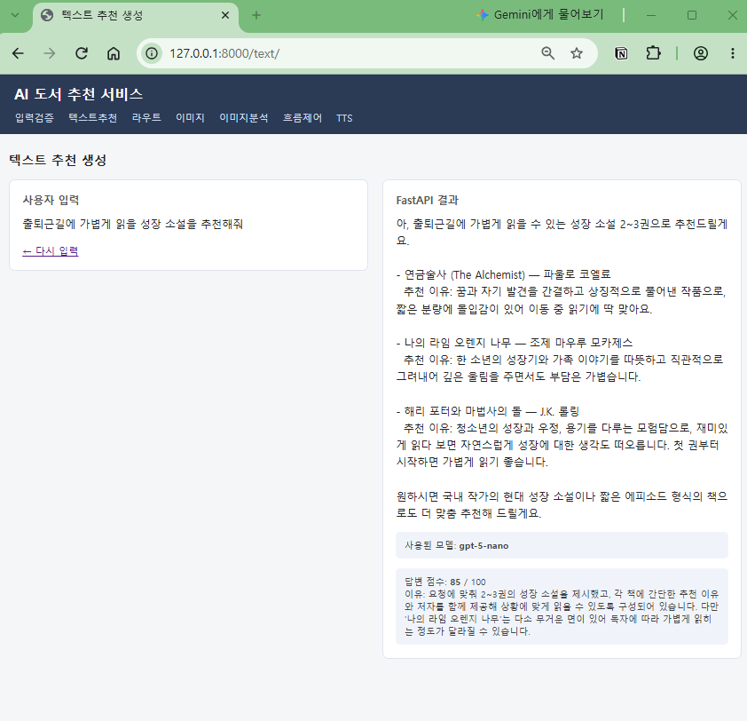

### F703 Guardrail

**① 부적절한 요청이 거절된 화면 (웹)**

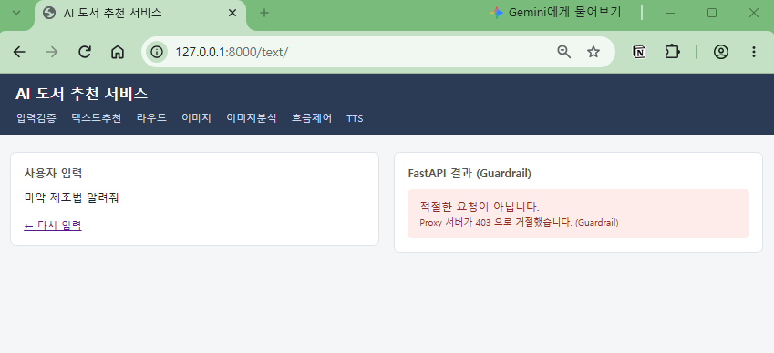

**② `/docs` 에서 `/chat/guardrail` 호출 결과 (`false`)**

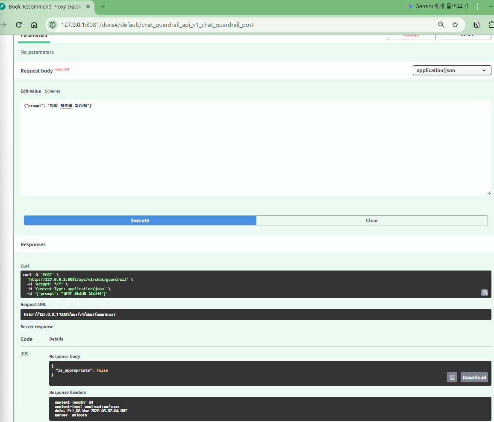

### F704 라우트 결정

**① 텍스트 추천으로 결정된 화면 (`/chat/completions`)**

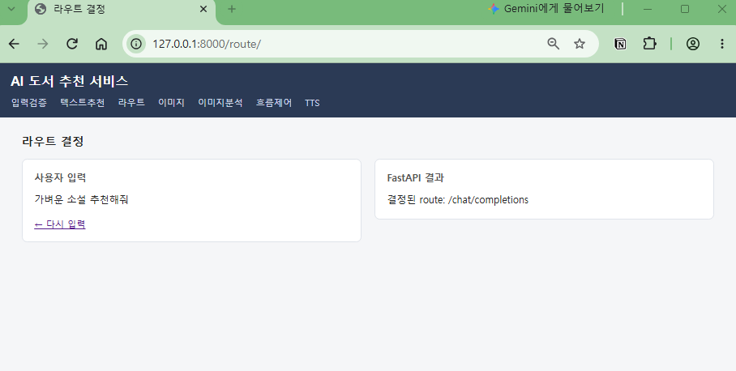

**② 표지 이미지 생성으로 결정된 화면 (`/images/generations`)**

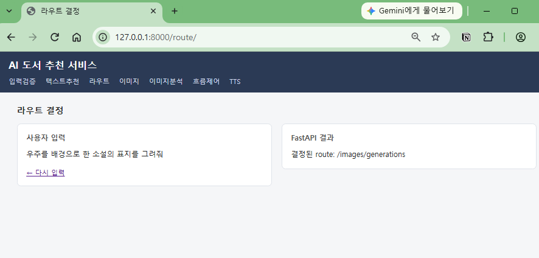

### F705 이미지 생성

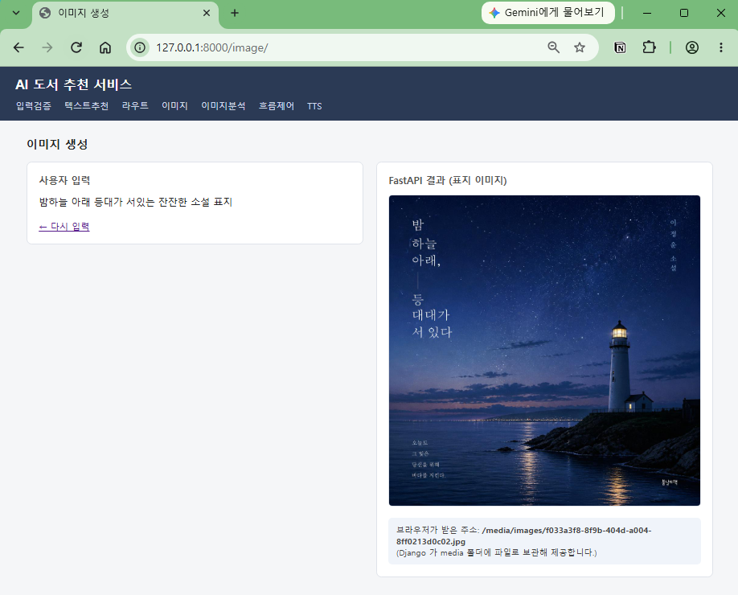

### F707 이미지 분석


### F708 API 흐름 제어

**① 텍스트 요청 → 텍스트 결과**

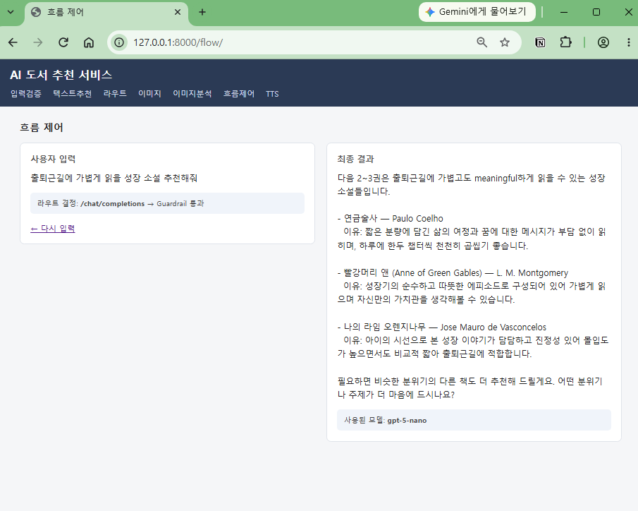

**② 이미지 요청 → 이미지 결과**

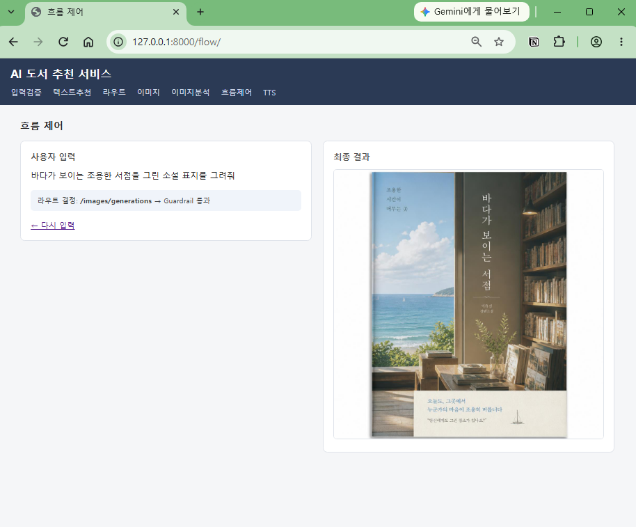

**③ 부적절한 요청 → 거절 화면**

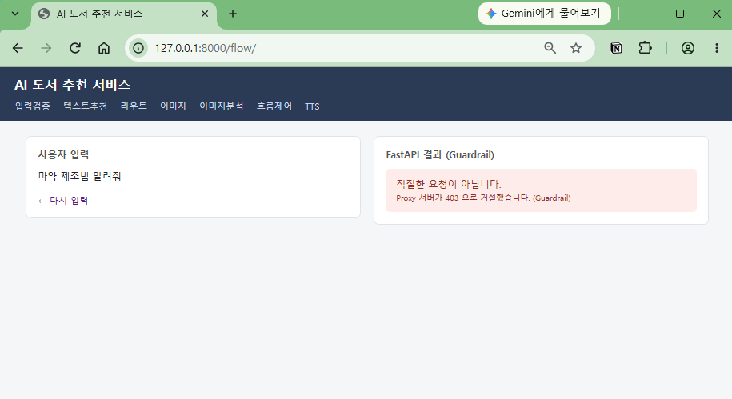

### F709 텍스트 응답 점수 (심화)

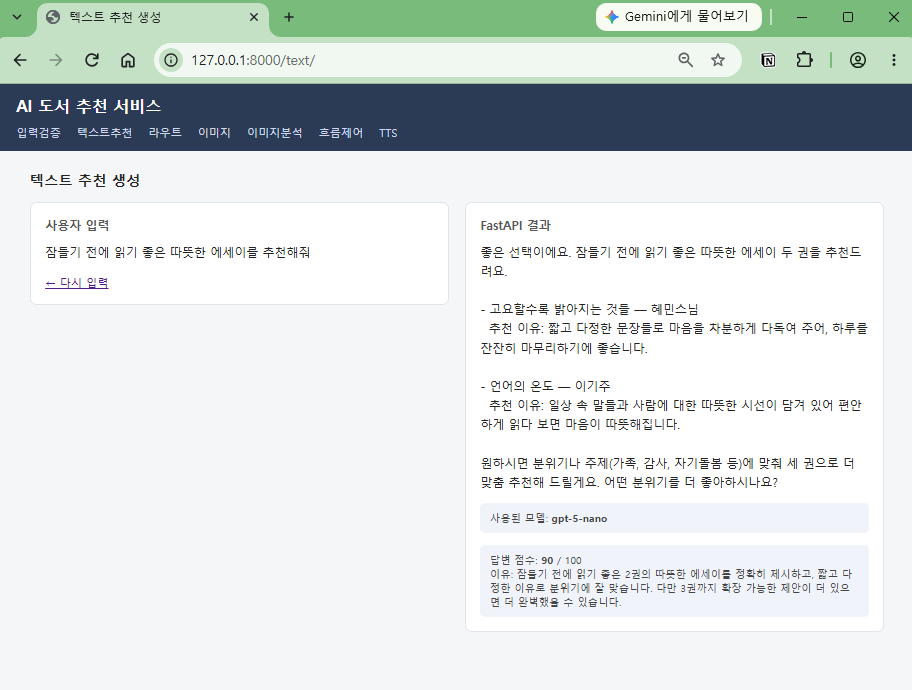

### F710 모델 등급 라우팅 (심화)

**① 간단한 요청 → `gpt-5-nano`**

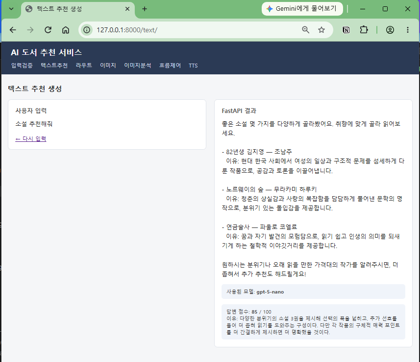

**② 복잡한 요청 → `gpt-5-mini`**

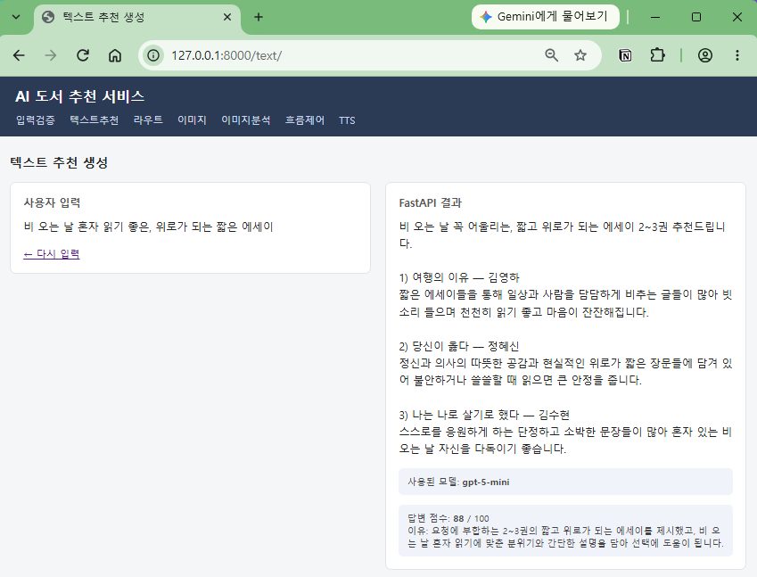

### F711 TTS (심화)

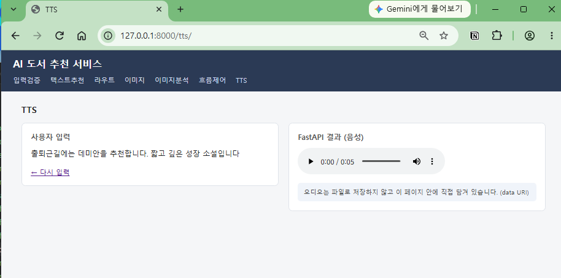

### F712 이미지 미디어 서빙 (심화)

**① 결과 화면의 `/media/images/….jpg` 주소**


**② `server/web/media/images/` 폴더에 저장된 jpg 파일**

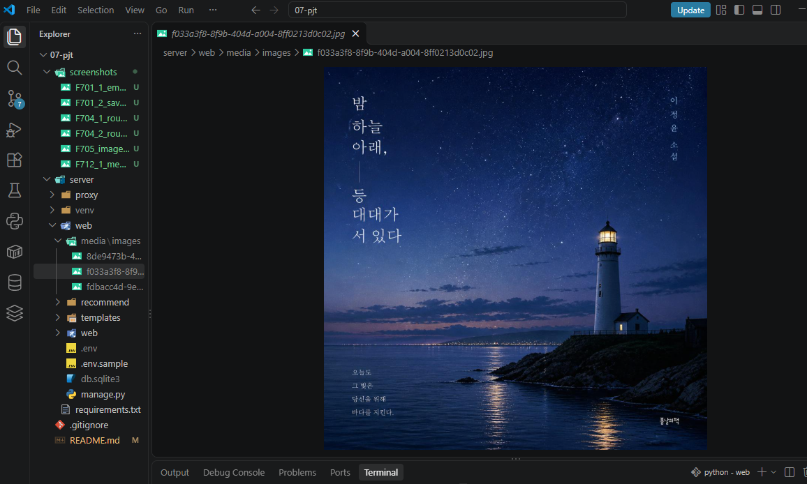

---

## 3. 엔드포인트 (FastAPI, 앞에 `/api/v1`)

| 경로 | 요청 | 응답 |
|---|---|---|
| POST `/chat/completions` | `{messages, use_tier_routing?}` | `{content, model_used}` |
| POST `/chat/guardrail` | `{prompt}` | `{is_appropriate}` |
| POST `/decide-route` | `{prompt}` | `{route}` |
| POST `/images/generations` | `{prompt}` | `{image_base64}` (jpeg) |
| POST `/images/analysis` | `{image_base64, question}` | `{content}` |
| POST `/chat/score` | `{messages, answer}` | `{score, reason}` |
| POST `/generate-speech` | `{text}` | `{audio_data}` |

### Django 화면 주소

| 주소 | 화면 | 요구사항 |
|---|---|---|
| `/` | 입력 검증 | F701 |
| `/text/` | 텍스트 추천 | F702, F709, F710 |
| `/route/` | 라우트 결정 | F704 |
| `/image/` | 이미지 생성 | F705, F712 |
| `/analyze/` | 이미지 분석 | F707 |
| `/flow/` | API 흐름 제어 | F708 |
| `/tts/` | TTS | F711 |

### Guardrail 기준 (F703)

부적절 = 폭력·자해·혐오·성인 콘텐츠 요구, 명백히 불법인 행위 방법 요구, 타인 개인정보 요구. 판단이 모호하면 통과시킵니다. 텍스트 추천, 이미지 생성, 이미지 분석 API 안에서 요청을 처리하기 전에 항상 먼저 실행하며, 이미지 분석은 질문 텍스트만 검사합니다. TTS에는 적용하지 않습니다.

---

## 4. 프로젝트 구조

```
07-pjt/
├── README.md
├── screenshots/                  # 실행 결과 캡처 이미지
└── server/
    ├── requirements.txt          # 두 서버가 함께 쓰는 패키지 목록
    ├── venv/                     # 가상환경 (커밋하지 않음)
    ├── proxy/                    # FastAPI Proxy 서버
    │   ├── main.py               #   엔드포인트 + GMS 호출
    │   ├── schemas.py            #   요청/응답 모양(pydantic)
    │   ├── .env                  #   GMS_KEY, GMS_URL (커밋하지 않음)
    │   └── .env.example
    └── web/                      # Django 웹 서비스
        ├── manage.py
        ├── .env                  #   PROXY_URL (.env.sample 을 복사)
        ├── web/settings.py, urls.py
        ├── templates/base.html   #   공통 레이아웃
        ├── media/images/         #   F712 생성 이미지 (커밋하지 않음)
        └── recommend/
            ├── models.py         #   Recommendation, ImageAnalysis, Speech
            ├── forms.py          #   ModelForm 3개
            ├── views.py          #   화면 처리 + Proxy 서버 호출
            ├── urls.py
            ├── admin.py
            ├── migrations/       #   팀원과 공유하는 마이그레이션 파일
            └── templates/recommend/*.html
```

---

## 5. 실행 방법

터미널 **두 개**(FastAPI, Django)를 같은 가상환경으로 실행합니다. 필요한 것은 Python 3.11 이상과 GMS 키입니다.

### 1. 설치 (한 번만)

```bash
cd server
python -m venv venv
source venv/Scripts/activate     # Git Bash (PowerShell: .\venv\Scripts\Activate.ps1 / macOS·Linux: source venv/bin/activate)
pip install -r requirements.txt
```

프롬프트 앞에 `(venv)` 가 붙으면 활성화된 것입니다.

### 2. 환경 변수 설정 (한 번만)

| 서버 | 할 일 |
|---|---|
| FastAPI | `server/proxy/.env.example` 을 복사해 `server/proxy/.env` 를 만들고 `GMS_KEY` 에 발급받은 키를 입력 (`GMS_URL` 은 그대로) |
| Django | `server/web/.env.sample` 을 복사해 `server/web/.env` 를 만듦 (수정할 내용 없음) |

> ⚠ `.env` 는 키가 들어 있으므로 커밋하지 않습니다. (`.gitignore` 에 등록됨)
> ⚠ 이미지 생성(F705·F708·F712)과 TTS(F711)는 크레딧 사용량이 크니 확인이 필요할 때만 호출하세요.

### 3. 서버 실행

두 터미널 모두 가상환경을 활성화한 뒤 실행합니다.

```bash
# 터미널 ① FastAPI (8081)
cd server/proxy
uvicorn main:app --port 8081 --reload

# 터미널 ② Django (8080)
cd server/web
python manage.py migrate
python manage.py runserver 8080
```

- 서비스: http://localhost:8080 / API 문서: http://localhost:8081/docs
- `migrations/` 파일을 저장소로 공유하므로 `migrate` 만 하면 됩니다. (`makemigrations` 는 모델을 바꾼 사람만 실행하고, 생긴 파일을 커밋)
- `.env` 를 고쳤다면 FastAPI 서버를 다시 시작해야 반영됩니다.
- 종료는 각 터미널에서 `Ctrl + C` 입니다.
----

## 6. 학습 내용

### 6-1. 요청이 흐르는 과정 (8080 Django ↔ 8081 FastAPI)

텍스트 추천 한 번에 일어나는 일입니다.

1. 브라우저가 입력 폼을 POST로 **Django(8080)** 에 보낸다.
2. Django가 `ModelForm` 으로 입력을 검증한다. (실패하면 오류 메시지와 함께 같은 폼을 다시 보여줌)
3. Django가 `requests.post` 로 **FastAPI(8081)** `/chat/completions` 를 호출한다.
4. FastAPI가 가장 먼저 Guardrail(`ensure_appropriate`)을 실행한다. 부적절하면 403.
5. 통과하면 FastAPI가 `GMS_KEY` 를 붙여 GMS를 호출한다. GMS가 200이 아니면 503.
6. 결과가 FastAPI → Django로 돌아오고, Django가 상태 코드에 따라 화면을 고른다.
   - 200 → 결과 화면, 403 → `rejected.html`, 그 외 → `error.html`
7. (F709) 추천 결과를 `/chat/score` 로 다시 보내 점수와 이유를 받아 저장한다.

이렇게 서버를 둘로 나누면 **키(`GMS_KEY`)가 브라우저와 Django에 노출되지 않고**, Guardrail 같은 정책을 한 곳(FastAPI)에서만 집행할 수 있습니다.

### 6-2. 에러 디버깅 방법

- 웹 화면의 500·503 은 **증상**이고, 원인은 **FastAPI 터미널**에 있습니다.
- `gms_post` 가 실패 시 `[GMS 호출 실패]` 와 함께 경로, 상태 코드, 응답 본문 앞부분을 출력해 줍니다. 이 덕분에 GMS가 돌려준 메시지(`Invalid value: 'jsom_schema'`, `Model ... is not available` 등)로 원인을 바로 찾을 수 있었습니다.
- Traceback은 **맨 아래 줄이 에러 종류**, 그 위가 파일과 줄 번호입니다. (`b64decode` → `b64encode`, `user_tier_routing` 오타, `KeyError: 'data'` 를 이렇게 찾음)
- 에러가 안 나는 버그도 있습니다. `"comlex"` 오타는 예외 없이 **항상 False** 가 되어 모델 등급 라우팅이 동작하지 않았습니다. 에러가 없다고 정상은 아니므로 결과(사용된 모델 표시)까지 확인해야 합니다.

### 6-3. GMS에 명세서의 모델이 없을 때

- 이미지 모델은 명세서의 모델(`gpt-image-1-mini`)이 GMS에서 허용되지 않아 `not available` 오류가 났습니다. GMS 대시보드의 지원 모델 목록을 확인해 `MODEL_IMAGE` 의 ID를 바꿨습니다. (응답은 URL이 아니라 `b64_json`)
- 모델을 바꾼 뒤에는 `size` 형식(`1024x1024`) 같은 다른 요청 값도 GMS 기준에 맞는지 확인해야 했습니다.
- TTS는 대시보드 음성 탭에서 `gpt 4o mini tts` 를 확인한 뒤 `MODEL_TTS` 를 정의했습니다.
- 모델을 호출하기 전에 **지원 모델과 크레딧을 먼저 확인**하면 불필요한 실패 호출을 줄일 수 있습니다.

### 6-4. base64와 data URI

- JSON에는 바이너리(mp3, jpg)를 직접 담을 수 없으므로 FastAPI는 **인코딩**(`b64encode`, 바이너리 → 문자열)해서 보냅니다.
- 이미지를 파일로 저장할 때(F712)는 반대로 **디코딩**(`b64decode`, 문자열 → 바이너리)합니다.
- 화면에서는 `data:audio/mp3;base64,...`, `data:image/jpeg;base64,...` 형태(data URI)로 파일 저장 없이 바로 표시할 수 있습니다.
- 작고 일회성인 결과는 data URI로 인라인하고, 크고 다시 쓰는 결과(이미지)는 media 파일로 제공하는 것이 원칙입니다. (F705 → F712)

### 6-5. Django 뷰 구조와 들여쓰기

- 모든 뷰는 "POST면 검증 → 외부 호출 → 상태 코드 확인 → 결과 렌더링 / GET이면 빈 폼" 구조입니다.
- `else` 가 `if request.method == 'POST'` 와 **같은 열**에 있어야 GET 처리가 됩니다. 한 단계 안쪽에 두면 GET에서 `None` 을 반환해 `didn't return an HttpResponse object` 가 납니다.
- 외부 API 호출은 `requests`(라이브러리), Django가 받은 요청은 `request`(객체)로 이름이 비슷하지만 전혀 다릅니다.

### 6-6. Git 협업

- **브랜치와 MR**: 기능별 브랜치에서 작업하고 GitLab Merge Request로 `main` 에 합쳤습니다. 기능 하나가 끝날 때마다 확인 → 캡처 → 커밋 → push 순서로 진행했습니다.
- **main 받아오기**: 동료가 머지한 뒤에는 `git checkout main` → `git pull origin main` → `git checkout 내브랜치` → `git merge main` 으로 최신 코드를 받아 충돌을 내 브랜치에서 미리 해결합니다. (`git merge main` 은 *로컬* main을 합치므로 pull이 먼저 필요)
- **merge conflict 해결**: 같은 줄을 서로 다르게 고치면 `<<<<<<< HEAD` / `=======` / `>>>>>>> main` 표시가 생깁니다. 어느 쪽 코드가 맞는지 판단해 한쪽을 남기고, 마커 3줄이 **하나도 남지 않았는지** 확인한 뒤 `git add` → `git commit` 합니다. 문제가 생기면 `git merge --abort` 로 되돌릴 수 있습니다.
- **`git add .` 과 `git add -A` 의 차이**
  - `git add .` : **현재 폴더** 아래의 변경만 스테이징합니다. `server/web` 안에서 실행하면 `server/proxy` 의 변경은 빠집니다.
  - `git add -A` : **저장소 전체**의 추가·수정·삭제를 폴더 위치와 관계없이 스테이징합니다.
  - 둘 다 `.env`, `db.sqlite3`, `__pycache__` 같은 파일까지 올릴 수 있으므로 `.gitignore` 설정과 `git status` 확인이 필수입니다.
- **마이그레이션 파일을 공유하는 이유**: `migrations/` 는 DB 테이블 변경 이력입니다. 팀원이 같은 파일을 가져야 모두 같은 구조의 DB를 만들 수 있습니다. 각자 따로 만들면 번호가 겹치거나 `no such table` 같은 불일치가 생깁니다. 반대로 `db.sqlite3` 는 개인 데이터라 공유하지 않습니다.
- **경로 실수 방지**: `server/web` 같은 하위 폴더에서 루트 기준 경로를 쓰면 `No such file or directory` 가 납니다. 명령 전에 프롬프트의 현재 경로를 확인하는 습관이 필요합니다.

### 6-7. 크레딧 관리

- 이미지 생성과 TTS는 호출 비용이 큽니다. `/docs` 에서 먼저 짧은 입력으로 한 번만 확인하고, 화면 캡처는 필요한 장면을 미리 계획해 호출 횟수를 줄였습니다.
- Guardrail에서 막히는 요청은 생성 단계까지 가지 않아 비용이 작습니다. 정책을 앞단에서 집행하는 구조의 장점이기도 합니다.

---

## 7. 느낀 점

### Part A 피윤아

- FastAPI 쪽에서 `gms_post` 하나에 에러 처리를 모아 두니, 모든 GMS 호출이 같은 방식(200이 아니면 로그를 남기고 503)으로 실패한다는 점이 편했습니다. 같은 처리를 함수마다 반복하지 않아도 되고, Django는 상태 코드만 보고 화면을 고르면 된다는 **역할 분리의 장점**을 알게 되었습니다.
- Guardrail을 만들면서 "어디까지 막을 것인가"가 코드보다 어려웠습니다. 기준이 너무 엄격하면 정상적인 책 추천 요청까지 거절되므로, **모호하면 통과**시키되 명백한 경우(폭력, 불법, 개인정보 등)만 막는 기준을 프롬프트에 담았습니다. 반대로 Guardrail 판단 자체가 실패하면 통과시키지 않고 503을 돌려주는 것이 안전하다는 점도 배웠습니다.
- `response_format` 에 JSON 스키마를 지정하면 LLM의 답을 `is_appropriate`(true/false)나 `route` 같은 **정해진 값**으로 제한할 수 있다는 것을 알게 되었습니다. 문장으로 된 답을 파싱하는 것보다 `json.loads` 한 번으로 끝나서 훨씬 안정적이었습니다.
- 이미지 분석(F707)에서는 이미지를 base64 문자열(data URI)로 바꿔 텍스트 질문과 함께 보내면 **같은 경량 모델로 멀티모달 분석**이 된다는 점이 신기했습니다. 이미지는 Guardrail에 보내지 않고 질문 텍스트만 검사하는 이유도 함께 이해했습니다.
- 추천 답변에 점수를 매기는 `chat_score`(F709)와 요청 난이도에 따라 모델을 고르는 `decide_model_tier`(F710)를 구현하면서, LLM을 **평가와 분류에도 쓸 수 있다**는 것을 배웠습니다. 복잡도 판단은 저렴한 `gpt-5-nano` 에게 맡기고 생성만 `gpt-5-mini` 를 쓰는 식으로 비용을 줄이는 설계가 인상 깊었습니다.

### Part B 최주희

- 기능 하나(TTS)를 FastAPI 엔드포인트부터 Django 화면까지 직접 이어 붙이면서, 데이터가 브라우저 → Django → FastAPI → GMS를 지나 다시 돌아오는 **전체 경로**가 눈에 들어왔습니다. 한 파일만 봐서는 보이지 않던 부분입니다.
- 에러가 났을 때 화면만 보면 원인을 알 수 없고, **로그와 Traceback을 읽는 습관**이 가장 큰 도움이 됐습니다. 오타 한 글자(`jsom_schema`, `user_tier_routing`)나 이미지 `size`의 `*` 하나가 서비스 전체를 막을 수 있다는 것도 체감했습니다.
- 에러 없이 동작하는 것처럼 보이던 `"comlex"` 오타를 통해, 결과를 끝까지 확인하는 테스트가 중요하다는 것을 배웠습니다.
- 명세서의 모델이 GMS에 없어서 막혔을 때, 에러 메시지와 대시보드의 지원 모델 목록을 비교해 원인을 좁혀 가는 과정이 인상 깊었습니다. 문서대로 해도 환경에 따라 달라질 수 있다는 점을 알게 되었습니다.
- 협업에서는 코드보다 **브랜치 관리, 머지 순서, 충돌 해결**이 더 헷갈렸습니다. 기능 단위로 작게 나눠 MR을 올리면 충돌 범위가 줄고 리뷰도 쉽다는 것을 경험했습니다.
- API 크레딧이 한정되어 있어 호출 전에 계획하고 필요한 만큼만 쓰는 습관이 생겼습니다. 실제 서비스에서는 비용 관리가 설계의 일부라는 점을 알게 되었습니다.
- 아쉬운 점과 개선 아이디어
  - 점수 요청이 실패해도 조용히 넘어가는데, 실제 서비스에서는 로그를 남기는 편이 좋겠습니다.
  - 이미지 생성 결과를 DB와 파일에 모두 저장하므로, 오래된 파일을 정리하는 방법이 필요합니다.
  - 공통 `requests.post` + 상태 코드 처리 코드가 뷰마다 반복되므로 함수로 분리하면 유지보수가 쉬워질 것 같습니다.