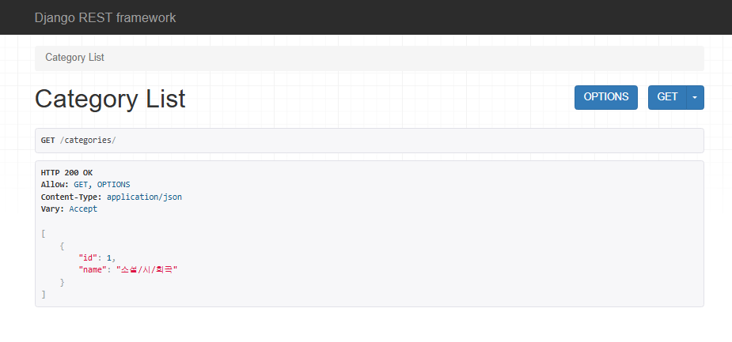
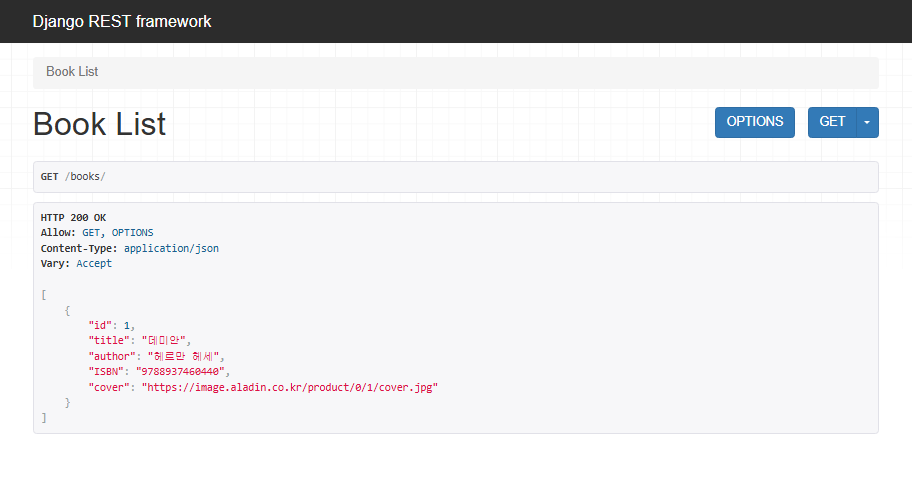
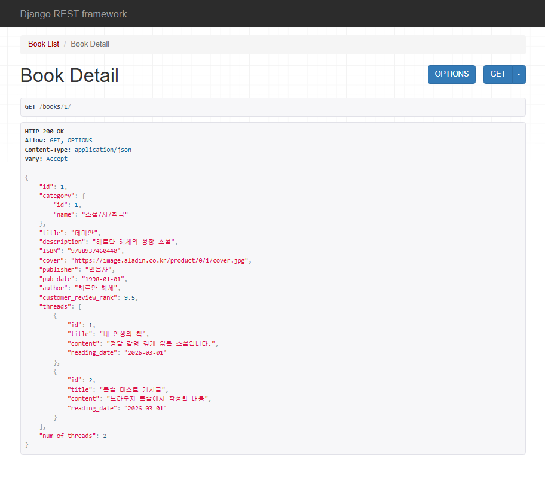
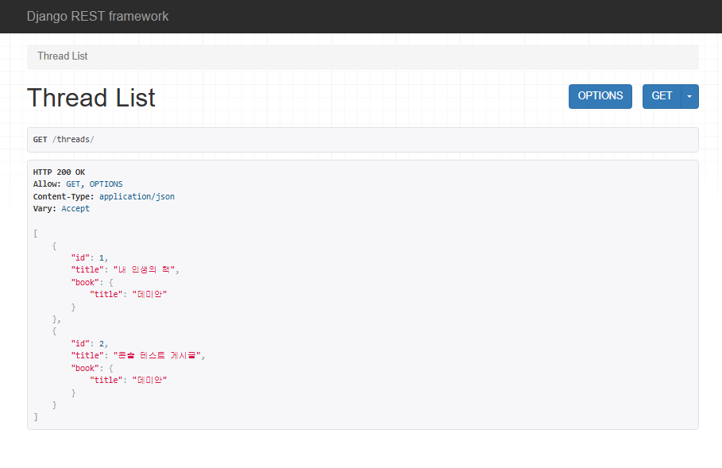
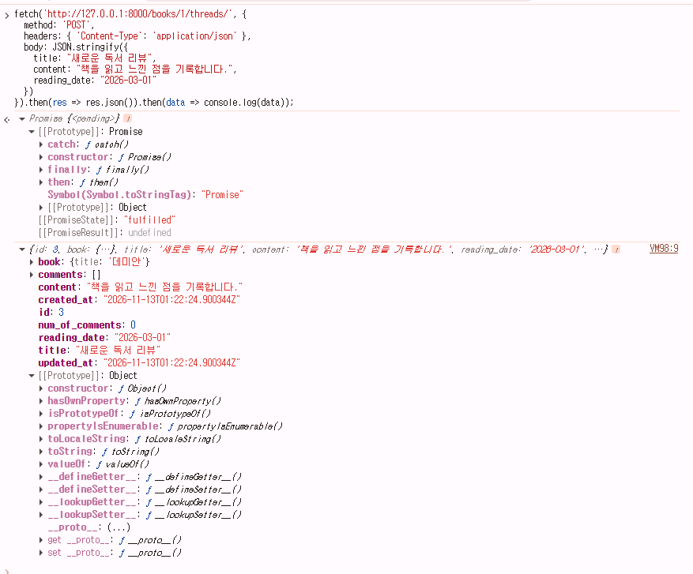
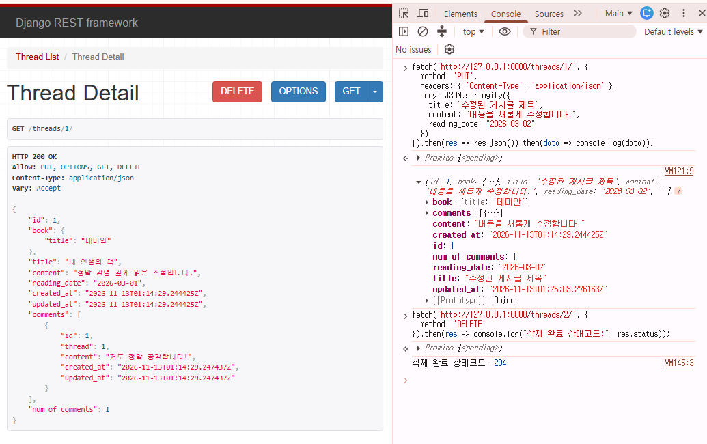
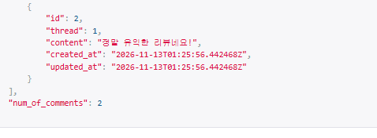
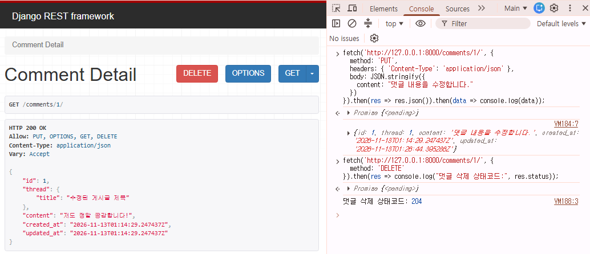

# 📚 AI 기반 도서 분석과 창작 지원 통합 솔루션 서비스 (REST API)

## 1. 프로젝트 개요

- **프로젝트명**: `08-pjt` (DB 설계를 활용한 REST API 설계)
- **개발 환경**: Python 3.11, Django 5.2, Django REST Framework (DRF)
- **목표**: 도서(`Book`), 카테고리(`Category`), 게시글(`Thread`), 댓글(`Comment`) 간의 1:N(Many-to-One) 관계를 모델링하고, HTTP Method 및 상태 코드를 준수하는 RESTful API 서버 구현

---

## 2. 팀원 구성 및 역할 분담

원활한 협업과 코드 충돌 방지를 위해 도메인 및 기능 단위로 역할을 분담하여 개발을 진행했습니다.

| 구분       | 담당 영역                                 | 주요 구현 내용                                                                                                                                                                                                                                     |
| ---------- | ----------------------------------------- | -------------------------------------------------------------------------------------------------------------------------------------------------------------------------------------------------------------------------------------------------- |
| **안소현** | **프로젝트 세팅 & 도서/카테고리 도메인**  | - Django 프로젝트(`mypjt`) 및 `books` 앱 초기 환경 구성 (`F801`) - `Category`, `Book` 모델 및 관계 설계 (`F802`, `F803`) - 전체 카테고리 조회(`F807`), 전체/단일 도서 조회(`F808`, `F809`) API 구현 - 초기 데이터 시딩 및 API 테스트 검증 |
| **최주희** | **커뮤니티(게시글/댓글) 도메인 & 문서화** | - `Thread`, `Comment` 모델 및 외래키(N:1) 관계 설계 (`F804`, `F805`) - 게시글 목록/상세 CRUD(`F810`, `F811`, `F812`) API 구현 - 댓글 생성 및 상세 CRUD(`F813`, `F814`) API 구현 - Git 브랜치 전략 관리(`NF801`) 및 최종 `README.md` 작성  |

---

## 3. Git 활용 및 협업 원칙 (NF801)

- **Branch 전략**:
  - `main`: 최종 완료된 안정 버전 관리
  - `develop`: 기능 개발 통합 브랜치
  - `feature/books`, `feature/community`: 각 팀원별 독립 기능 구현 브랜치 운영 후 Merge
- **Commit 규칙**: `[Feat] 기능 구현`, `[Fix] 오류 수정`, `[Docs] 문서 작성` 형식으로 목적을 명확히 기록

---

## 4. 주요 기능 구현 및 실행 결과

### ① 전체 카테고리 목록 조회 (`F807`)

- **Endpoint**: `GET /categories/`

- **설명**: 등록된 모든 도서 카테고리의 `id`와 `name`을 반환합니다.
  

### ② 전체 도서 목록 조회 (`F808`)

- **Endpoint**: `GET /books/`

- **설명**: 전체 도서의 `id`, 제목, 저자, ISBN, 커버 이미지 URL을 조회합니다.
  

### ③ 단일 도서 상세 조회 (`F809`)

- **Endpoint**: `GET /books/<int:book_pk>/`

- **설명**: 특정 도서의 상세 정보와 함께 카테고리 정보, 해당 도서에 작성된 게시글 목록(`threads`), 총 게시글 수(`num_of_threads`)를 중첩 직렬화(Nested Serializer)하여 반환합니다.
  

### ④ 전체 게시글 목록 조회 (`F810`)

- **Endpoint**: `GET /threads/`

- **설명**: 작성된 모든 게시글의 `id`, 제목과 대상 도서의 제목(`book.title`)을 함께 조회합니다.
  

### ⑤ 게시글 생성 (`F812`)

- **Endpoint**: `POST /books/<int:book_pk>/threads/`

- **설명**: 특정 도서(`book_pk`)에 대한 새로운 독서 리뷰 게시글을 생성하고 `201 Created` 상태를 반환합니다.
  

### ⑥ 단일 게시글 조회, 수정, 삭제 (`F811`)

- **Endpoint**: `GET / PUT / DELETE /threads/<int:thread_pk>/`

- **설명**: 단일 게시글의 상세 정보(댓글 목록 및 개수 포함) 조회, 유효성 검증을 거친 부분 수정(`PUT`), 삭제(`DELETE`, `204 No Content`)를 수행합니다.
  

### ⑦ 댓글 생성 (`F813`)

- **Endpoint**: `POST /threads/<int:thread_pk>/comments/`

- **설명**: 특정 게시글(`thread_pk`)에 새로운 댓글을 등록하고 `201 Created` 응답을 반환합니다.
  

### ⑧ 단일 댓글 조회, 수정, 삭제 (`F814`)

- **Endpoint**: `GET / PUT / DELETE /comments/<int:comment_pk>/`

- **설명**: 단일 댓글 정보(대상 게시글 제목 포함) 조회, 수정(`PUT`), 삭제(`DELETE`, `204 No Content`) 기능을 제공합니다.
  

---

## 5. 개발 과정에서의 어려웠던 점 및 해결 방법

1. **중첩 직렬화(Nested Serializer)와 읽기 전용 필드(`read_only_fields`) 처리**

   - **어려웠던 점**: 게시글(`Thread`)이나 댓글(`Comment`)을 생성(`POST`)할 때, URL 경로로 전달받는 외래키(`book_pk`, `thread_pk`)를 Serializer 유효성 검사(`is_valid()`) 단계에서 필수 입력값으로 요구하여 `400 Bad Request`가 발생하는 문제가 있었습니다.

   - **해결 방법**: 외래키 필드를 `read_only_fields`로 지정하거나 중첩 Serializer에 `read_only=True` 옵션을 부여하고, `serializer.save(book=book)` 형태로 뷰 함수에서 직접 객체를 주입하여 해결했습니다.

2. **요구사항별 출력 필드 최적화**

   - **어려웠던 점**: 목록 조회(`book_list`, `thread_list`)와 상세 조회(`book_detail`, `thread_detail`)에서 요구하는 JSON 응답 필드 구성이 달라 단일 Serializer로는 불필요한 데이터가 노출되는 문제가 있었습니다.

   - **해결 방법**: 용도에 따라 `BookListSerializer`와 `BookDetailSerializer`, `ThreadListSerializer`와 `ThreadDetailSerializer`를 명확히 분리하고 `SerializerMethodField`를 활용해 게시글 및 댓글 개수(`num_of_threads`, `num_of_comments`)를 동적으로 계산해 반환하도록 설계했습니다.

---

## 6. 프로젝트를 통해 느낀 점

- **최주희**:

  > "단순히 DB 테이블을 만드는 것을 넘어, N:1 관계에서 역참조(`related_name`)와 Serializer를 어떻게 설계하느냐에 따라 API 응답 구조가 얼마나 깔끔해질 수 있는지 체감했습니다. 특히 `Thread`와 `Comment`처럼 연결된 모델은 처음 설계할 때부터 관계를 명확히 정의해야 한다는 점을 배웠습니다."
  > 
  > "또한 HTTP 상태 코드(`200`, `201`, `204`, `400`, `405`)를 상황에 맞게 명확히 반환하는 것이 프론트엔드와 협업할 때 얼마나 중요한 약속인지 깨달았습니다. 응답 규칙을 일관되게 지키니 API 명세만 봐도 결과를 예측할 수 있었습니다."

- **안소현**:

  > "RESTful URL 설계 원칙에 맞춰 자원의 계층 구조(`/books/<id>/threads/`, `/threads/<id>/comments/`)를 표현하고, 허용된 HTTP Method만 동작하도록 `@api_view` 데코레이터로 제어하면서 API 서버의 보안성과 일관성을 높이는 경험을 했습니다."
  > 
  > "프로젝트 초기 환경과 `Category`, `Book` 모델을 설계하면서, 처음 세운 구조가 이후 모든 기능의 기반이 된다는 점에서 책임감을 느꼈습니다. 팀원과 사전에 모델 필드명과 브랜치 규칙을 맞춘 덕분에 병합 충돌 없이 빠르게 기능을 완성할 수 있었습니다."